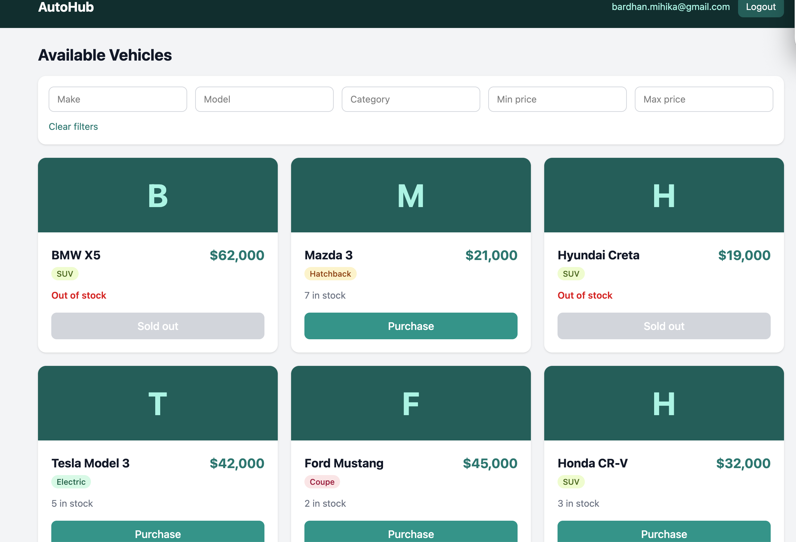
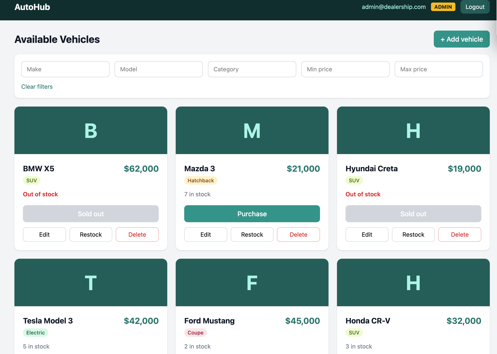

# PROMPTS

Raw, unedited AI chat log for this project (Claude). Pasted as copied from the chat window.

---

Last login: Sat Oct 24 21:39:36 on ttys000
mihikabardhan@MacBook-Air-4 ~ % TOKEN=$(curl -s -X POST localhost:4000/api/auth/login -H 'Content-Type: application/json' -d '{"email":"admin@dealership.com","password":"admin123"}' | node -pe "JSON.parse(require('fs').readFileSync(0)).token")
curl -s localhost:4000/api/vehicles -H "Authorization: Bearer $TOKEN" | head -c 300
echo
curl -s localhost:4000/api/vehicles
[{"id":8,"make":"BMW","model":"X5","category":"SUV","price":62000,"quantity":1},{"id":7,"make":"Mazda","model":"3","category":"Hatchback","price":21000,"quantity":7},{"id":6,"make":"Hyundai","model":"Creta","category":"SUV","price":19000,"quantity":0},{"id":5,"make":"Tesla","model":"Model 3","catego
{"error":"Missing token"}%                                                                            mihikabardhan@MacBook-Air-4 ~ % git status
fatal: not a git repository (or any of the parent directories): .git
mihikabardhan@MacBook-Air-4 ~ % git add src/server.ts src/seed.ts
fatal: not a git repository (or any of the parent directories): .git
mihikabardhan@MacBook-Air-4 ~ % cd ~/car-dealership-inventory/backend
mihikabardhan@MacBook-Air-4 backend % git status
On branch main
Untracked files:
  (use "git add <file>..." to include in what will be committed)
	src/seed.ts
	src/server.ts

nothing added to commit but untracked files present (use "git add" to track)
mihikabardhan@MacBook-Air-4 backend % git add src/server.ts src/seed.ts
mihikabardhan@MacBook-Air-4 backend % git commit -m "feat: add server entry point and seed script" -m "Claude drafted both files. I ran the server, seeded the db and tested login and the protected route with curl." -m "Co-authored-by: Claude <noreply@anthropic.com>"
[main 5d43a2a] feat: add server entry point and seed script
 2 files changed, 59 insertions(+)
 create mode 100644 backend/src/seed.ts
 create mode 100644 backend/src/server.ts
mihikabardhan@MacBook-Air-4 backend % echo "coverage-report.txt" >> .gitignore
mihikabardhan@MacBook-Air-4 backend % git add .gitignore
mihikabardhan@MacBook-Air-4 backend % git commit -m "chore: ignore local coverage report"
[main aaa4da3] chore: ignore local coverage report
 1 file changed, 1 insertion(+)
mihikabardhan@MacBook-Air-4 backend % npm run coverage 2>&1 | tee coverage-report.txt

> backend@1.0.0 coverage
> jest --runInBand --coverage

PASS tests/vehicles.test.ts
PASS tests/auth.test.ts
PASS tests/inventory.test.ts
PASS tests/search.test.ts
--------------------|---------|----------|---------|---------|-------------------
File                | % Stmts | % Branch | % Funcs | % Lines | Uncovered Line #s 
--------------------|---------|----------|---------|---------|-------------------
All files           |   96.72 |     93.4 |     100 |    97.2 |                   
 src                |   93.33 |       50 |     100 |   93.33 |                   
  app.ts            |    90.9 |       50 |     100 |    90.9 | 29-30             
  db.ts             |     100 |      100 |     100 |     100 |                   
  types.ts          |     100 |      100 |     100 |     100 |                   
 src/middleware     |     100 |      100 |     100 |     100 |                   
  auth.ts           |     100 |      100 |     100 |     100 |                   
 src/routes         |   97.77 |       75 |     100 |   97.72 |                   
  auth.ts           |     100 |      100 |     100 |     100 |                   
  vehicles.ts       |   96.87 |       75 |     100 |   96.77 | 10                
 src/services       |    96.8 |    94.93 |     100 |    97.8 |                   
  userService.ts    |   95.83 |    94.44 |     100 |   95.83 | 35                
  vehicleService.ts |   97.14 |    95.08 |     100 |    98.5 | 16                
--------------------|---------|----------|---------|---------|-------------------

Test Suites: 4 passed, 4 total
Tests:       45 passed, 45 total
Snapshots:   0 total
Time:        4.187 s
Ran all test suites.
mihikabardhan@MacBook-Air-4 backend % git log --oneline
aaa4da3 (HEAD -> main) chore: ignore local coverage report
5d43a2a feat: add server entry point and seed script
184984d refactor: extract shared validation helpers
07ea86e feat: purchase and restock endpoints (green)
650c8dd test: add purchase and restock tests (red)
58024dd feat: vehicle search endpoint (green)
5e1d6f3 test: add search tests (red)
c8efc7d feat: vehicle CRUD with admin-only delete (green)
ef20f70 test: add vehicle CRUD tests (red)
4aa41de feat: implement register/login and jwt middleware (green)
579ad9f test: add auth tests (red)
64d8c07 chore: init backend with typescript, jest, express
mihikabardhan@MacBook-Air-4 backend % cd ~/car-dealership-inventory
npm create vite@latest frontend -- --template react
cd frontend
npm install
npm install tailwindcss @tailwindcss/vite
rm -f src/App.css
rm -rf src/assets
Need to install the following packages:
create-vite@9.3.1
Ok to proceed? (y) y


> npx
> "cva" frontend --template react


create-vite v9.3.1

│
◇  Which linter to use?
│  Oxlint
│
◇  Install with npm and start now?
│  Yes
│
◇  Scaffolding project in /Users/mihikabardhan/car-dealership-inventory/frontend...
│
◇  Installing dependencies with npm...

added 24 packages, and audited 25 packages in 22s

9 packages are looking for funding
  run `npm fund` for details

found 0 vulnerabilities
│
◇  Starting dev server...

> frontend@0.0.0 dev
> vite


  VITE v8.3.5  ready in 2602 ms

  ➜  Local:   http://localhost:5173/
  ➜  Network: use --host to expose
  ➜  press h + enter to show help
^C
mihikabardhan@MacBook-Air-4 car-dealership-inventory % cd ~/car-dealership-inventory/frontend
mihikabardhan@MacBook-Air-4 frontend % npm install tailwindcss @tailwindcss/vite

added 18 packages, and audited 43 packages in 3s

12 packages are looking for funding
  run `npm fund` for details

found 0 vulnerabilities
mihikabardhan@MacBook-Air-4 frontend % rm -f src/App.css
mihikabardhan@MacBook-Air-4 frontend % rm -rf src/assets
mihikabardhan@MacBook-Air-4 frontend % ls
index.html		package-lock.json	public			src
node_modules		package.json		README.md		vite.config.js
mihikabardhan@MacBook-Air-4 frontend % npm run dev

> frontend@0.0.0 dev
> vite

1:36:40 am [vite] (client) Re-optimizing dependencies because lockfile has changed

  VITE v8.3.5  ready in 671 ms

  ➜  Local:   http://localhost:5173/
  ➜  Network: use --host to expose
  ➜  press h + enter to show help
^C
mihikabardhan@MacBook-Air-4 frontend % cat > vite.config.js <<'EOF'
import tailwindcss from '@tailwindcss/vite'
import react from '@vitejs/plugin-react'
import { defineConfig } from 'vite'

export default defineConfig({
  plugins: [react(), tailwindcss()],
  server: {
    // during development, forward /api calls to the express server
    proxy: { '/api': 'http://localhost:4000' },
  },
})
EOF
echo '@import "tailwindcss";' > src/index.css
cat > src/main.jsx <<'EOF'
import { StrictMode } from 'react'
import { createRoot } from 'react-dom/client'
import App from './App.jsx'
import './index.css'

createRoot(document.getElementById('root')).render(
  <StrictMode>
    <App />
  </StrictMode>,
)
EOF
sed -i '' 's#<title>.*</title>#<title>AutoHub Dealership</title>#' index.html
mkdir -p src/components
mihikabardhan@MacBook-Air-4 frontend % >....                                                          

  // DELETE returns 204 with no body
  const data = res.status === 204 ? null : await res.json()
  if (!res.ok) {
    throw new Error(data?.error || 'Request failed')
  }
  return data
}

export const api = {
  register: (email, password) => request('/api/auth/register', { method: 'POST', body: { email, password } }),
  login: (email, password) => request('/api/auth/login', { method: 'POST', body: { email, password } }),

  getVehicles: (token) => request('/api/vehicles', { token }),
  searchVehicles: (token, filters) => {
    // drop empty filters so the url stays clean
    const params = new URLSearchParams()
    Object.entries(filters).forEach(([key, value]) => {
      if (value !== '') params.append(key, value)
    })
    return request(`/api/vehicles/search?${params.toString()}`, { token })
  },
  addVehicle: (token, vehicle) => request('/api/vehicles', { method: 'POST', body: vehicle, token }),
  updateVehicle: (token, id, vehicle) => request(`/api/vehicles/${id}`, { method: 'PUT', body: vehicle, token }),
  deleteVehicle: (token, id) => request(`/api/vehicles/${id}`, { method: 'DELETE', token }),
  purchase: (token, id) => request(`/api/vehicles/${id}/purchase`, { method: 'POST', body: { quantity: 1 }, token }),
  restock: (token, id, quantity) => request(`/api/vehicles/${id}/restock`, { method: 'POST', body: { quantity }, token }),
}
EOF
mihikabardhan@MacBook-Air-4 frontend % cat > src/App.jsx <<'EOF'
import { useState } from 'react'
import AuthForm from './components/AuthForm'
import Dashboard from './components/Dashboard'

// Keep the login in localStorage so a page refresh doesn't log you out
function loadSession() {
  try {
    return JSON.parse(localStorage.getItem('session')) || null
  } catch {
    return null
  }
}

export default function App() {
  const [session, setSession] = useState(loadSession)

  function handleLogin(data) {
    localStorage.setItem('session', JSON.stringify(data))
    setSession(data)
  }

  function handleLogout() {
    localStorage.removeItem('session')
    setSession(null)
  }

  if (!session) {
    return <AuthForm onLogin={handleLogin} />
  }

  return <Dashboard token={session.token} user={session.user} onLogout={handleLogout} />
}
EOF
mihikabardhan@MacBook-Air-4 frontend % >....                                                          
            <label className="block text-sm font-medium text-gray-700 mb-1">Password</label>
            <input type="password" required minLength={6} value={password} onChange={(e) => setPassword(e.target.value)} className={inputClass} />
          </div>

          {error && <p className="text-sm text-red-600 bg-red-50 rounded-lg px-3 py-2">{error}</p>}

          <button
            type="submit"
            disabled={loading}
            className="w-full bg-teal-600 hover:bg-teal-700 text-white font-semibold py-2.5 rounded-lg transition disabled:opacity-50"
          >
            {loading ? 'Please wait...' : mode === 'login' ? 'Sign in' : 'Register'}
          </button>
        </form>

        <p className="text-sm text-gray-500 mt-6 text-center">
          {mode === 'login' ? "Don't have an account? " : 'Already registered? '}
          <button
            onClick={() => {
              setMode(mode === 'login' ? 'register' : 'login')
              setError('')
            }}
            className="text-teal-600 font-medium hover:underline"
          >
            {mode === 'login' ? 'Register' : 'Sign in'}
          </button>
        </p>
      </div>
    </div>
  )
}
EOF
mihikabardhan@MacBook-Air-4 frontend % cat > src/components/Dashboard.jsx <<'EOF'
// temporary placeholder, the real dashboard comes in the next step
export default function Dashboard({ user, onLogout }) {
  return (
    <div className="p-8">
      <p>Logged in as {user.email} ({user.role})</p>
      <button onClick={onLogout} className="mt-4 bg-gray-800 text-white px-4 py-2 rounded-lg">
        Logout
      </button>
    </div>
  )
}
EOF
mihikabardhan@MacBook-Air-4 frontend % npm run dev

> frontend@0.0.0 dev
> vite

1:40:28 am [vite] (client) Re-optimizing dependencies because vite config has changed

  VITE v8.3.5  ready in 1763 ms

  ➜  Local:   http://localhost:5173/
  ➜  Network: use --host to expose
  ➜  press h + enter to show help
^C
mihikabardhan@MacBook-Air-4 frontend % cd ~/car-dealership-inventory
mihikabardhan@MacBook-Air-4 car-dealership-inventory % git status
On branch main
Untracked files:
  (use "git add <file>..." to include in what will be committed)
	frontend/

nothing added to commit but untracked files present (use "git add" to track)
mihikabardhan@MacBook-Air-4 car-dealership-inventory % git add .
mihikabardhan@MacBook-Air-4 car-dealership-inventory % git commit -m "feat: frontend scaffold with api layer and login form" -m "Claude drafted the api helper and auth form. I ran it against my backend and tested register, login and a wrong password." -m "Co-authored-by: Claude <noreply@anthropic.com>"
[main 9cec025] feat: frontend scaffold with api layer and login form
 15 files changed, 2127 insertions(+)
 create mode 100644 frontend/.gitignore
 create mode 100644 frontend/.oxlintrc.json
 create mode 100644 frontend/README.md
 create mode 100644 frontend/index.html
 create mode 100644 frontend/package-lock.json
 create mode 100644 frontend/package.json
 create mode 100644 frontend/public/favicon.svg
 create mode 100644 frontend/public/icons.svg
 create mode 100644 frontend/src/App.jsx
 create mode 100644 frontend/src/api.js
 create mode 100644 frontend/src/components/AuthForm.jsx
 create mode 100644 frontend/src/components/Dashboard.jsx
 create mode 100644 frontend/src/index.css
 create mode 100644 frontend/src/main.jsx
 create mode 100644 frontend/vite.config.js
mihikabardhan@MacBook-Air-4 car-dealership-inventory % cat > src/components/SearchBar.jsx <<'EOF'
export default function SearchBar({ filters, onChange, onClear }) {
  // update one filter and keep the others
  const set = (field) => (e) => onChange({ ...filters, [field]: e.target.value })

  const inputClass =
    'border border-gray-300 rounded-lg px-3 py-2 text-sm w-full focus:outline-none focus:ring-2 focus:ring-teal-500'

  return (
    <div className="bg-white rounded-xl shadow-sm p-4 mb-5">
      <div className="grid gap-3 grid-cols-2 md:grid-cols-5">
        <input className={inputClass} placeholder="Make" value={filters.make} onChange={set('make')} />
        <input className={inputClass} placeholder="Model" value={filters.model} onChange={set('model')} />
        <input className={inputClass} placeholder="Category" value={filters.category} onChange={set('category')} />
        <input className={inputClass} type="number" min="0" placeholder="Min price" value={filters.minPrice} onChange={set('minPrice')} />
        <input className={inputClass} type="number" min="0" placeholder="Max price" value={filters.maxPrice} onChange={set('maxPrice')} />
      </div>
      <button onClick={onClear} className="mt-3 text-sm text-teal-700 hover:underline">
        Clear filters
      </button>
    </div>
  )
}
EOF
zsh: no such file or directory: src/components/SearchBar.jsx
mihikabardhan@MacBook-Air-4 car-dealership-inventory % >....                                          
        {vehicle.make[0]}
      </div>

      <div className="p-5 flex flex-col flex-1">
        <div className="flex items-start justify-between gap-2">
          <div>
            <h3 className="text-lg font-bold text-gray-900">
              {vehicle.make} {vehicle.model}
            </h3>
            <span className={`inline-block mt-1 text-xs font-medium px-2 py-0.5 rounded-full ${badge}`}>
              {vehicle.category}
            </span>
          </div>
          <p className="text-xl font-bold text-teal-700">${vehicle.price.toLocaleString()}</p>
        </div>

        <p className={`text-sm mt-3 ${outOfStock ? 'text-red-600 font-semibold' : 'text-gray-500'}`}>
          {outOfStock ? 'Out of stock' : `${vehicle.quantity} in stock`}
        </p>

        <button
          onClick={onPurchase}
          disabled={outOfStock}
          className="mt-4 w-full bg-teal-600 hover:bg-teal-700 text-white font-medium py-2 rounded-lg transition disabled:bg-gray-300 disabled:cursor-not-allowed"
        >
          {outOfStock ? 'Sold out' : 'Purchase'}
        </button>
      </div>
    </div>
  )
}
EOF
zsh: no such file or directory: src/components/VehicleCard.jsx
mihikabardhan@MacBook-Air-4 car-dealership-inventory % >....                                          

      <main className="max-w-6xl mx-auto px-4 py-6">
        <h2 className="text-2xl font-bold text-gray-900 mb-4">Available Vehicles</h2>

        <SearchBar filters={filters} onChange={setFilters} onClear={() => setFilters(emptyFilters)} /> 

        {message && (
          <div
            className={`mb-4 px-4 py-3 rounded-lg text-sm ${
              message.type === 'success' ? 'bg-green-100 text-green-800' : 'bg-red-100 text-red-800'
            }`}
          >
            {message.text}
          </div>
        )}

        {loading ? (
          <p className="text-gray-500">Loading vehicles...</p>
        ) : vehicles.length === 0 ? (
          <p className="text-gray-500 bg-white rounded-xl p-8 text-center">No vehicles match your search.</p>
        ) : (
          <div className="grid gap-5 sm:grid-cols-2 lg:grid-cols-3">
            {vehicles.map((v) => (
              <VehicleCard key={v.id} vehicle={v} onPurchase={() => handlePurchase(v)} />
            ))}
          </div>
        )}
      </main>
    </div>
  )
}
EOF
zsh: no such file or directory: src/components/Dashboard.jsx
mihikabardhan@MacBook-Air-4 car-dealership-inventory % cd ~/car-dealership-inventory
mihikabardhan@MacBook-Air-4 car-dealership-inventory % git status
On branch main
nothing to commit, working tree clean
mihikabardhan@MacBook-Air-4 car-dealership-inventory % git add .
mihikabardhan@MacBook-Air-4 car-dealership-inventory % git commit -m "feat: dashboard with vehicle cards, search and purchase" -m "Claude drafted the components. I tested the filters, the purchase flow and the disabled sold-out button in the browser." -m "Co-authored-by: Claude <noreply@anthropic.com>"
On branch main
nothing to commit, working tree clean
mihikabardhan@MacBook-Air-4 car-dealership-inventory % cd ~/car-dealership-inventory/frontend
pwd
/Users/mihikabardhan/car-dealership-inventory/frontend
mihikabardhan@MacBook-Air-4 frontend % cat > src/components/SearchBar.jsx <<'EOF'
export default function SearchBar({ filters, onChange, onClear }) {
  // update one filter and keep the others
  const set = (field) => (e) => onChange({ ...filters, [field]: e.target.value })

  const inputClass =
    'border border-gray-300 rounded-lg px-3 py-2 text-sm w-full focus:outline-none focus:ring-2 focus:ring-teal-500'

  return (
    <div className="bg-white rounded-xl shadow-sm p-4 mb-5">
      <div className="grid gap-3 grid-cols-2 md:grid-cols-5">
        <input className={inputClass} placeholder="Make" value={filters.make} onChange={set('make')} />
        <input className={inputClass} placeholder="Model" value={filters.model} onChange={set('model')} />
        <input className={inputClass} placeholder="Category" value={filters.category} onChange={set('category')} />
        <input className={inputClass} type="number" min="0" placeholder="Min price" value={filters.minPrice} onChange={set('minPrice')} />
        <input className={inputClass} type="number" min="0" placeholder="Max price" value={filters.maxPrice} onChange={set('maxPrice')} />
      </div>
      <button onClick={onClear} className="mt-3 text-sm text-teal-700 hover:underline">
        Clear filters
      </button>
    </div>
  )
}
EOF
mihikabardhan@MacBook-Air-4 frontend % >....                                                          
        {vehicle.make[0]}
      </div>

      <div className="p-5 flex flex-col flex-1">
        <div className="flex items-start justify-between gap-2">
          <div>
            <h3 className="text-lg font-bold text-gray-900">
              {vehicle.make} {vehicle.model}
            </h3>
            <span className={`inline-block mt-1 text-xs font-medium px-2 py-0.5 rounded-full ${badge}`}>
              {vehicle.category}
            </span>
          </div>
          <p className="text-xl font-bold text-teal-700">${vehicle.price.toLocaleString()}</p>
        </div>

        <p className={`text-sm mt-3 ${outOfStock ? 'text-red-600 font-semibold' : 'text-gray-500'}`}>
          {outOfStock ? 'Out of stock' : `${vehicle.quantity} in stock`}
        </p>

        <button
          onClick={onPurchase}
          disabled={outOfStock}
          className="mt-4 w-full bg-teal-600 hover:bg-teal-700 text-white font-medium py-2 rounded-lg transition disabled:bg-gray-300 disabled:cursor-not-allowed"
        >
          {outOfStock ? 'Sold out' : 'Purchase'}
        </button>
      </div>
    </div>
  )
}
EOF
mihikabardhan@MacBook-Air-4 frontend % >....                                                          

      <main className="max-w-6xl mx-auto px-4 py-6">
        <h2 className="text-2xl font-bold text-gray-900 mb-4">Available Vehicles</h2>

        <SearchBar filters={filters} onChange={setFilters} onClear={() => setFilters(emptyFilters)} /> 

        {message && (
          <div
            className={`mb-4 px-4 py-3 rounded-lg text-sm ${
              message.type === 'success' ? 'bg-green-100 text-green-800' : 'bg-red-100 text-red-800'
            }`}
          >
            {message.text}
          </div>
        )}

        {loading ? (
          <p className="text-gray-500">Loading vehicles...</p>
        ) : vehicles.length === 0 ? (
          <p className="text-gray-500 bg-white rounded-xl p-8 text-center">No vehicles match your search.</p>
        ) : (
          <div className="grid gap-5 sm:grid-cols-2 lg:grid-cols-3">
            {vehicles.map((v) => (
              <VehicleCard key={v.id} vehicle={v} onPurchase={() => handlePurchase(v)} />
            ))}
          </div>
        )}
      </main>
    </div>
  )
}
EOF
mihikabardhan@MacBook-Air-4 frontend % ls src/components
AuthForm.jsx	Dashboard.jsx	SearchBar.jsx	VehicleCard.jsx
mihikabardhan@MacBook-Air-4 frontend % npm run dev

> frontend@0.0.0 dev
> vite


  VITE v8.3.5  ready in 336 ms

  ➜  Local:   http://localhost:5173/
  ➜  Network: use --host to expose
  ➜  press h + enter to show help
^C
mihikabardhan@MacBook-Air-4 frontend % cd ~/car-dealership-inventory
mihikabardhan@MacBook-Air-4 car-dealership-inventory % git status
On branch main
Changes not staged for commit:
  (use "git add <file>..." to update what will be committed)
  (use "git restore <file>..." to discard changes in working directory)
	modified:   frontend/src/components/Dashboard.jsx

Untracked files:
  (use "git add <file>..." to include in what will be committed)
	frontend/src/components/SearchBar.jsx
	frontend/src/components/VehicleCard.jsx

no changes added to commit (use "git add" and/or "git commit -a")
mihikabardhan@MacBook-Air-4 car-dealership-inventory % git add .
mihikabardhan@MacBook-Air-4 car-dealership-inventory % git commit -m "feat: dashboard with vehicle cards, search and purchase" -m "Claude drafted the components. I tested the filters, the purchase flow and the disabled sold-out button in the browser." -m "Co-authored-by: Claude <noreply@anthropic.com>"
[main 649288e] feat: dashboard with vehicle cards, search and purchase
 3 files changed, 161 insertions(+), 7 deletions(-)
 create mode 100644 frontend/src/components/SearchBar.jsx
 create mode 100644 frontend/src/components/VehicleCard.jsx
mihikabardhan@MacBook-Air-4 car-dealership-inventory % cd ~/car-dealership-inventory
git add .
git commit -m "feat: admin UI to add, edit, restock and delete vehicles" -m "Claude drafted the form and handlers." -m "Co-authored-by: Claude <noreply@anthropic.com>"
On branch main
nothing to commit, working tree clean
mihikabardhan@MacBook-Air-4 car-dealership-inventory % cd ~/car-dealership-inventory
mihikabardhan@MacBook-Air-4 car-dealership-inventory % mkdir -p screenshots
mihikabardhan@MacBook-Air-4 car-dealership-inventory % mv ~/Desktop/login.png ~/Desktop/dashboard.png ~/Desktop/admin.png screenshots/
mv: rename /Users/mihikabardhan/Desktop/login.png to screenshots/login.png: Too many levels of symbolic links
mv: rename /Users/mihikabardhan/Desktop/dashboard.png to screenshots/dashboard.png: Too many levels of symbolic links
mv: rename /Users/mihikabardhan/Desktop/admin.png to screenshots/admin.png: Too many levels of symbolic links
mihikabardhan@MacBook-Air-4 car-dealership-inventory % git rm -f frontend/README.md
rm 'frontend/README.md'
mihikabardhan@MacBook-Air-4 car-dealership-inventory % >....                                          
- `createApp(db)` takes the database as a parameter so tests use their own database file.
- Purchase is a single `UPDATE ... WHERE quantity >= ?`, so two buyers cannot take the last car.
- Admins cannot be created through the API (seed script only), to prevent privilege escalation.
- All SQL uses `?` placeholders.
- Known limits: token stored in localStorage, no pagination, no frontend tests.

## Screenshots




## My AI Usage
**Tools:** Claude (Anthropic).

**How I used it:** Claude suggested the stack and project structure and drafted the auth, vehicle CRUD, search, server/seed code and the React frontend. For the inventory feature I wrote the purchase/restock tests myself from written rules, wrote the purchase/restock code with hints from Claude, and did the validation refactor in small steps, running the tests after each one. I ran the app and tested login, search, purchase and admin actions in the browser. Commits where Claude helped carry a Co-authored-by trailer. The full chat is linked in PROMPTS.md.

**Reflection:** AI saved a lot of time on boilerplate and made it easy to follow red-green-refactor. It also handed me code I had to read before I could explain it, so I went through each file and the concepts (JWT, bcrypt, 401 vs 403, SQL injection, race conditions) to be able to discuss them. Writing the inventory tests and code myself taught me more than reading generated code.

## Test report
```bash
cd backend && npm test        # or: npm run coverage
```
EOF
echo '```' >> README.md
cat backend/coverage-report.txt >> README.md
echo '```' >> README.md
mihikabardhan@MacBook-Air-4 car-dealership-inventory % cat > PROMPTS.md <<'EOF'
# PROMPTS

Raw AI chat log for this project (Claude), shared as a public link:

- PASTE_YOUR_SHARE_LINK_HERE

(If I used any other AI tool, its link goes here too.)
EOF
nano PROMPTS.md
mihikabardhan@MacBook-Air-4 car-dealership-inventory % cd ~/car-dealership-inventory
cat > PROMPTS.md <<'EOF'
# PROMPTS

Raw, unedited AI chat log for this project (Claude). Pasted as copied from the chat window.

---

EOF
mihikabardhan@MacBook-Air-4 car-dealership-inventory % 
